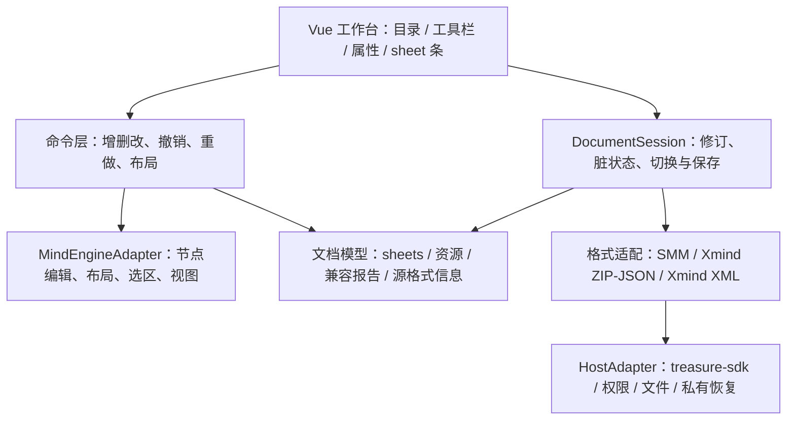

# Treasure 思维导图插件：技术调研与 UI 方案

本方案将“像 Xmind 一样编辑思维导图，并从左侧目录打开文件”落实为技术选择、格式合同、文件操作和界面规格。**建议优先验证专用思维导图内核，再开发 Treasure 外壳、兼容适配器与文件会话层。** 推荐候选不是已验证结论；本次只读调研，没有运行 PoC、产品测试或性能跑分。

正文中的“建议”“目标”和“阶段”都是本次方案的提案，不能视为用户已经同意缩减范围。当前仓库是 Treasure 插件仓库，因此暂按 Vue + Vite + treasure-sdk 设计；如果目标宿主另有其人，保留编辑与格式层，替换宿主适配层即可。[本地研究记录](council/source-local.md)

## 1. 推荐路线与适用条件

建议选择 **Vue 3 + TypeScript + Vite 工作台，SimpleMindMap 为首选 PoC 候选，Mind Elixir 为并行对照，应用自持文档模型与格式适配层**。先验证 `.smm` 原生编辑、中文输入、SVG 导出和 Treasure 生命周期，再决定正式依赖；不能仅凭演示效果拍板。

| 决策提案 | 理由与条件 | 不通过时的路径 |
| --- | --- | --- |
| ADR-01：SimpleMindMap 优先验证 | 思绪 `.smm` 是其原生 JSON，已有节点编辑、布局和常用插件；必须接受低维护状态并有人承担锁版与修补 | 同样例对照 Mind Elixir；若高级自由主题是首版硬门槛，两者都不能直接据演示认定合格 |
| ADR-02：默认支持工作簿级模型 | Xmind 是多 sheet 文件，不能只取第一张图 | 没有持久化完整工作簿的能力前，不发布“完整多 sheet 支持” |
| ADR-03：推荐新增 `.treasuremind` 原生包 | 一个用户文件保存多 sheet、资源、来源原包和兼容报告；这是插件自定义格式提案，须通过 PoC 再定 schema | 普通单 sheet 可直接用 `.smm`；整本导出逐 sheet `.smm` 是明确有损的交换路径，不替代原生包 |
| ADR-04：Xmind 先导入副本，按兼容等级导出 | 专用库并不保证 Xmind 高级语义和样式往返；原文件保护优先 | 不通过写出验证时禁用该导出项，保留原生保存与报告，不伪装成功 |
| ADR-05：显式保存＋私有恢复草稿 | SDK 未提供可靠替换、锁与监听接口 | 自动回写外部源文件留待宿主能力和冲突处理验证后再启用 |

SimpleMindMap 的开源库/Web 已进入低维护状态，而客户端和 Obsidian/uTools 等宿主插件闭源并继续维护；这会改变长期成本，不能把闭源产品的更多布局或自由节点算入可直接集成的开源能力。[当前 README](https://github.com/wanglin2/mind-map)、[开源能力边界](https://github.com/wanglin2/mind-map/blob/main/README_MORE_ZH.md)

本方案推荐的是“常规脑图编辑＋明确互通边界”的产品路线。AI、实时协作、云同步和演示不自动进入首版；这是建议的阶段划分，用户仍可调整优先级。

## 2. 研究边界与本地基线

证据访问日为 **2026-11-04**。官方产品文档证明“提供某项功能”，不能证明市场占有率，也不能证明开源候选具备相同保真度。视觉部分采用当前产品可观察到的布局、主题和编辑模式作为参考，具体配色和尺寸属于本方案设计建议。

当前 Excalidraw 插件可作为宿主接入和目录体验参考，不能直接当作新的思维导图编辑器：现有导入器仅从 `.xmind` 读取第一张 sheet 的标题与树，优先解析 `content.json`、否则 `content.xml`；`.smm` 同样简化成树，富文本转成纯文本。现有 domain 只有单一向右布局。新的插件应独立建目录和会话层，抽取可复用的服务职责，重新实现切换保护与格式合同。[现有导入器](../../excalidraw/src/services/mind-map-import-service.ts)、[导图 domain](../../excalidraw/src/domain/mind-map.ts)

宿主基线以本机 SDK 2.1.1 类型声明和开发指南为准。当前 Excalidraw 使用 `^2.1.1` 不代表新插件已经选定或验证此版本；新插件在 PoC 时锁定确切版本、提交 lockfile，并重新核查能力。[SDK 类型](../../excalidraw/node_modules/treasure-sdk/dist/index.d.ts)、[开发指南](../PLUGIN-DEVELOPMENT-GUIDE.md)

## 3. Xmind 功能参照与交付边界

Xmind 当前官方指南覆盖主题、结构、关系、概要、边界、大纲和多 sheet；它不是只有标题与父子线的树编辑器。下表“首版/后续”是本方案的实施建议，不表示已实现，也不表示 Xmind 所有套餐均可用这些功能。[官方指南](https://xmind.com/user-guide)、[套餐差异](https://xmind.com/pricing)

| Xmind 真实能力与官方依据 | 本插件建议 | 差距和进入条件 |
| --- | --- | --- |
| 中心/主/子主题、富文本和多种结构，[Topic](https://xmind.com/user-guide/topic-editing-new) | 首版完成键盘增删、拖动重排、折叠、备注、图片、标记；左右/向右/向下三种主结构 | 混合布局、矩阵、树表等逐项验证后加入，不强行映射成相同外观 |
| 独立关系线、标签、端点/控制点，[Relationship](https://xmind.com/user-guide/relationship-new) | 首版目标为基础跨节点关系；单独模型，不与父子线混用 | 高级端点、曲率、箭头和连接对象不支持时保留/报告，不能暗示完全可编辑 |
| 范围边界与标题，[Boundary](https://xmind.com/user-guide/boundary-new) | 验证连续兄弟范围的基础边界 | 引擎无对应能力时置灰；未知边界保留为来源数据，视觉不能造假 |
| 概要主题还能添加子主题，[Summary](https://xmind.com/user-guide/summary-new) | 首版仅在通过门槛后开放基础概要 | SMM 开源库不支持概要节点继续加节点；复杂概要保持不可编辑，需进一步扩展或改换路线 |
| 多 sheet 一起保存、重命名和复制，[Sheet](https://xmind.com/user-guide/sheet-new) | 工作簿打开、切 sheet、全本保存；增删/重命名进入应用层 | 普通 `.smm` 只有单 sheet；完整多 sheet 必须另存 `.treasuremind` |
| 自由主题及子树，[Floating Topic](https://xmind.com/user-guide/floating-topic) | 模型预留独立主题森林，来源内容保留并报告 | SMM MIT 核心不能直接提供多根自由节点；首版不承诺编辑它们 |
| 同步大纲，[Outliner](https://xmind.com/user-guide/outliner-new) | 共享文档模型的大纲导航和基础编辑 | 不另存一套树；与画布保持同一选区和修订 |
| 上下文 Format 和浮动工具条，[Style](https://xmind.com/user-guide/style-new)、[Floating Toolbar](https://xmind.com/user-guide/floating-toolbar) | 顶栏文件动作、选区轻工具条、右侧属性 | 工具按实际能力出现，避免概念图中的按钮成为未验证承诺 |
| 多格式、当前图/整本导出，[Export](https://xmind.com/user-guide/export-new) | 首版经验证后提供原生包、SMM、Xmind 兼容子集、PNG/SVG、Markdown | PDF 延后验证分页和栅格化；Office/PPT/演示不列首版必做 |

打开、关闭、删除与目录点选是用户明确提出的功能，具体行为以第 7 节为合同。目录属于本插件新增的工作台设计，借鉴当前仓库 Excalidraw 的文件服务分层，不声称它是 Xmind 固定界面。Xmind 当前指南的入口会随版本变化，不能把旧快捷键表照搬成当前默认。[官方更新记录](https://xmind.com/changelog)

视觉参照还包括 MindNode 的动态主题、同步大纲和拖放预览，以及 EdrawMind 的主题/对象属性分层。这里借鉴交互原则，不复制品牌、图标或商业主题资源。[MindNode 主题](https://www.mindnode.com/support/guides/themes)、[布局](https://www.mindnode.com/support/guides/mind-map-and-canvas-styling)、[EdrawMind 指南](https://edrawmind.wondershare.com/tablet-guide/)

## 4. 候选技术、渲染和布局

### 4.1 代表性候选比较

“主流”在本研究中指覆盖有代表性的产品与活跃生态类别，不是市场份额排行。各仓库维护/发布状态实施时需再核对并锁定 commit；除明确说明外，本轮没有获得可比的维护频率或性能数据。

| 候选 | 已核实的技术与能力 | 许可/维护观察 | 对本项目的判断 |
| --- | --- | --- | --- |
| **SimpleMindMap** | 框架无关；SVG，富文本可能含 `foreignObject`；多种脑图布局、RichText/Drag/Select/Export 等公开能力插件；原生 `.smm` | 核心 MIT；仓库 main 观察到 `0.14.0-fix.3`，非 npm 最新版证明；明确低维护 | 首选 PoC。最少 `.smm` 转换，但团队要承接 fork 和宿主问题；不能复用闭源客户端能力。[README](https://github.com/wanglin2/mind-map)、[源码依赖](https://raw.githubusercontent.com/wanglin2/mind-map/main/simple-mind-map/package.json) |
| **Mind Elixir** | HTML/DOM 节点＋SVG 线条，CSS 主题、双侧布局、拖拽、历史、关系/概要；官方导入包覆盖 JSON/XML Xmind 和多 sheets | 核心及导入包标示 MIT；当前 API/生态可核查，本轮未量化维护节奏 | 并行对照。`.smm` 需自写适配；导入包明确有自由主题/附件等限制。[核心文档](https://docs.mind-elixir.com/)、[Xmind 导入包](https://github.com/mind-elixir/import-xmind/blob/main/README.md) |
| **Markmap** | Markdown → 层次数据 → 交互 SVG | MIT；本轮未量化维护节奏 | 适合 Markdown 预览或轻量模式；图形直接编辑、SMM 和 Xmind 文件合同需另建，不作主编辑器首选。[官方文档](https://markmap.js.org/docs)、[仓库](https://github.com/gera2ld/markmap) |
| **AntV X6** | HTML/SVG 通用图编辑、自定义节点和编辑扩展 | MIT；本轮未量化维护节奏 | 当产品要扩展为流程/通用图平台时值得选；脑图命令、布局、文件语义自建成本较高。[官方介绍](https://x6.antv.antgroup.com/en/tutorial/about)、[仓库](https://github.com/antvis/X6) |
| **AntV G6** | 图可视化、Mindmap 布局与历史/小地图；默认 Canvas，支持 SVG/WebGL 与分层 renderer | MIT；本轮未量化维护节奏 | 适合关系图平台和数据可视化；布局示例不等于现成脑图文件编辑器。[布局](https://g6.antv.antgroup.com/en/manual/layout/mindmap-layout)、[渲染器](https://g6.antv.antgroup.com/en/manual/further-reading/renderer)、[仓库](https://github.com/antvis/G6) |
| **React Flow** | React 节点画布；自动布局需外接 Dagre、D3、ELK 等 | 核心 MIT；部分官方 Pro 示例另有许可 | 当前宿主采用 Vue，为此引入 React 并自建脑图格式/命令收益不足；若扩展到通用流程才重评。[布局说明](https://reactflow.dev/learn/layouting/layouting)、[许可证](https://github.com/xyflow/xyflow/blob/main/LICENSE) |
| **ELK/elkjs、Dagre** | 只负责布局，不提供脑图文档与编辑工作台 | ELK 为 EPL-2.0；Dagre 为 MIT；使用官方维护包，实施前复核版本 | 属于自研路线的布局组件；简单层次图可选 Dagre，端口/复杂层次约束可评估 ELK。[ELK](https://github.com/kieler/elkjs)、[Dagre](https://github.com/dagrejs/dagre) |

Xmind 的官方开发库应与上述编辑内核分开判断：`xmind-sdk-js` 用于构建文件，其 v2.2.0 已移除加载已有文件能力；可作为导出生成器候选，不能承担通用导入与无损回写。`xmind-viewer` 已归档且明确警告不要用于生产。`xmind-embed-viewer` 是可切 sheet 的只读包装，依赖远程 iframe，不适合本插件本地编辑主链路。[JS SDK](https://github.com/xmindltd/xmind-sdk-js)、[发布记录](https://github.com/xmindltd/xmind-sdk-js/releases)、[旧 viewer](https://github.com/xmindltd/xmind-viewer)、[embed viewer](https://github.com/xmindltd/xmind-embed-viewer)

### 4.2 渲染与布局取舍

建议先用具备脑图编辑语义的 SVG 或 DOM 内核，避免为选中、折叠、文本编辑和层级重排从头造轮子。SVG 有矢量路径、事件和导出优势，但节点多时 DOM 更新、字体和 `foreignObject` 导出仍需验证；DOM＋SVG 便于 CSS 与中文文本编辑，但尺寸测量和 DOM 转图片是一笔成本。Canvas/WebGL 为大规模图提供优化空间，却不能自动解决布局、富文本、输入法和可访问性；不能凭渲染类型宣称谁一定更快。[SMM 导出源码](https://raw.githubusercontent.com/wanglin2/mind-map/main/simple-mind-map/src/plugins/Export.js)、[Mind Elixir API](https://docs.mind-elixir.com/docs/api/mind-elixir.mindelixir)、[G6 renderer](https://g6.antv.antgroup.com/en/manual/further-reading/renderer)

首版使用内核现成布局，固定映射规则，后续才评估替换。常规树的尺寸由真实字体/图片测量决定，不能仅按标题字符数估宽。Xmind 的混合结构、自由位置、关系绕线与概要嵌套需要专门语义，通用自动布局不会自行补齐。本轮没有取得现行商业 Xmind 编辑内核的官方技术披露，不据此断言其使用 React、SVG、Canvas 或某种算法。

### 4.3 维护与许可成本

采用 SMM 的前置条件是指定维护责任、锁版并保存 fork；把修补中文输入、宿主 resize/销毁、导出兼容和升级回归纳入持续维护。官方能力插件 `src/plugins` 与闭源宿主产品是两回事。v0.12 后其他主题拆到 `simple-mind-map-plugin-themes`，官方称其免费，但“免费”不足以证明包内所有内容都是 MIT。[主题说明](https://wanglin2.github.io/mind-map-docs/plugins/themes.html)

MIT 文本要求副本保留版权与许可；SMM 官方文档另提出来源/署名展示要求。建议插件 About/开源声明列明项目来源并随包保留 LICENSE，复核锁定主题/扩展版本的许可；不要把 MIT 核心许可扩大到闭源客户端、商标或商业素材。[实际 MIT 文本](https://raw.githubusercontent.com/wanglin2/mind-map/main/LICENSE)、[官方许可说明](https://wanglin2.github.io/mind-map-docs/start/introduction.html)

## 5. 文件格式、可编辑范围与保存合同

### 5.1 识别与兼容等级

默认 `.smm` 指 **SimpleMindMap/思绪的 JSON 格式**，它支持节点树形式和包含 `layout/root/theme/view` 的完整配置。SimpleMind 是另一个产品，当前原生共享格式为 `.smmx`；不因名字相近或更改后缀自动互认。来自其他产品的 `.smm` 需要真实样本和独立适配器。[SMM 导入导出](https://wanglin2.github.io/mind-map-docs/course/course17.html)、[SimpleMind 格式说明](https://simplemind.eu/faq/share-in-mind-map-formats/)

先按内容探测，再按结构校验：JSON `.smm` 验证 root/节点/配置；`.xmind` 按 ZIP 探测，优先使用有效 `content.json`，没有时才处理 XML 族。JSON 族可能带一个兼容提示用的 `content.xml`，不能据此当作真实旧图。旧 XML 还涉及 `styles.xml`、manifest 与资源映射。加密/密码保护和无法识别版本首版明确拒绝或提示暂不支持，不静默变成空图。[官方 JSON dumper](https://github.com/xmindltd/xmind-sdk-js/blob/master/src/utils/dumper.ts)、[XML 常量](https://github.com/xmindltd/xmind-sdk-python/blob/master/xmind/core/const.py)

兼容分四层：**R 读取**、**E 可编辑**、**W 可写出**、**RT 往返保真**。可读取不等于可以原样回写。以下是建议的交付合同，全部须有样本验收；不是现成库已经证明通过的能力。

| 格式 | R / E 目标 | 保存/写出目标 | RT 与阶段边界 |
| --- | --- | --- | --- |
| `.treasuremind`，本插件自定义提案 | 全部受支持 sheet/资源；不支持项作为来源数据可保留但不可伪编辑 | 工作簿默认主保存；同一文件重新打开可恢复全部已编辑内容和来源包 | 保证自身 schema 的恢复；不因此保证 Xmind 重新导出保真；PoC 必须先验证 |
| 思绪完整配置 `.smm` | 单 sheet、布局、主题、视图、内核已支持的节点属性 | 普通单 sheet 可直接保存为 `.smm`；读取纯树时另存提示采用完整配置 | 对锁版已支持字段验证 RT；未知字段、跨版本插件字段不自动承诺 |
| JSON 族 `.xmind` | 枚举全部 sheet，基础树/文本/备注/图片等逐项映射并编辑 | 打开后标为“导入副本”；默认另存原生包；兼容导出目标为 JSON 族新文件 | 只对明确通过的语义子集声明 RT；不直接覆盖源 `.xmind` |
| XML 族 `.xmind` | 解析全部 sheet、资源和可映射样式 | 转为原生包；需 `.xmind` 时写新的 JSON 族副本 | 不承诺重建 XML 原版、旧应用可打开或跨版本无损 |
| Markdown / OPML / FreeMind `.mm` | 后续按文本层级优先级增量导入 | Markdown 首版候选，OPML/`.mm` 后续 | 文本交换不承载高级样式、图片附件与全部关系，导出要提示 |
| PNG / SVG / PDF | 静态交付，无节点编辑语义 | PNG/SVG 为首版候选；PDF 后续验证分页和大图 | 不可当作可编辑保存或恢复备份；当前 sheet/全部 sheet 范围明确 |

### 5.2 新原生包的明确提案

**推荐 `.treasuremind` 作为多 sheet 和复杂导入会话的主保存格式，名称与 schema 待 PoC 确认。它不是行业标准，也不是 Xmind/SMM 的扩展规范。** 建议采用 ZIP：`manifest.json` 保存 schema 版本和条目摘要，`document.json` 保存工作簿语义，`assets/` 存图片/附件，`sources/` 保存原始导入文件及格式识别信息，兼容报告作为可重算记录。格式适配器不能把应用专有字段偷塞进 `.smm` 并宣称其他软件能识别。

这样可以持久保存整个多 sheet 工作簿，关闭后从目录重新打开，恢复 sheet 顺序、已编辑基础内容、资源和来源证据。来源未知字段或未显示对象保留在原包中；UI 始终提醒“来源对象未在当前画布呈现”，不让用户误以为画布是全图。可在资源面板列出附件名称/类型/保存副本；复杂附件和自由主题不承诺图内编辑。修改已有节点后，未知语义可能不再匹配原节点关系，不能因此宣称导回 Xmind 无损。

代价是新增一套版本迁移、归档校验、资源索引、安全解压、文档说明和回归样本，并增加用户格式认知与跨应用转换成本；保存原文件还会增加磁盘和内存占用。不能依赖压缩压到 32 MiB 以内：包的压缩/解压总量和 SDK 读写均需限额；无法保存原始来源时必须在导入前明确说明并提供取消，不能到关闭时才发现无主保存路径。schema 高版本无法安全处理时只读或拒绝，迁移另存副本，保留旧文件。

新建常规单 sheet 可选择 `.smm`，只有受支持的单 sheet 语义时 `Cmd/Ctrl+S` 写回该文件。添加第二张 sheet、附件或非 SMM 语义前，先提示转存 `.treasuremind`，可选择取消操作。Xmind 打开的是导入会话，“保存”默认另存原生包；用户选择整本导出 SMM 时，每张 sheet 一个文件，使用 `原名-序号-sheet名.smm` 消除重名，并出具跨 sheet 结构/未知元素损失报告，原 `.xmind` 不变。私有恢复草稿无论写入是否成功，都不算用户文档已保存。

### 5.3 Xmind 语义映射与降级

| 内容 | 首版可编辑目标 | 保留/降级规则 |
| --- | --- | --- |
| 多 sheet 与基本主题树 | 全 sheet 列出、切换、修改标题/父子顺序，原生包整体保存 | 禁止默认只取第一张；sheet ID 和主题 ID 稳定映射 |
| 富文本、备注、链接、标记 | 对内核实际支持的子集编辑 | 富文本超出子集时原内容保留；需要转纯文本时先报告；未知标记不猜测图标含义 |
| 图片与附件 | 图片按实际资源解码/缩放；附件在资源面板保留和另存 | 解析包内引用，不能只保留临时 Blob URL；失效/缺失资源显示占位与原因 |
| 关系线 | 基础节点间关系在通过样本后开放 | 原端点/曲率等不支持属性保留为来源；不能画一条默认线就宣称同义 |
| 概要、边界 | 只开放内核已验证的范围语义 | 概要子树、复杂范围或样式不可编辑时保留并提示；不能当普通文本丢弃 |
| 自由主题、混合结构、特殊布局 | 基础可映射结构编辑 | SMM MIT 内核缺少自由多根和概要子节点等能力；保留来源、报告或切换引擎/扩展，不默默删掉 |
| 未知字段与资源 | 不承诺编辑 | 原始包/原始块保存；依赖分析不通过时只允许有损副本，不能拼接为“无损”Xmind |

SMM 当前解析器优先 JSON、支持多画布回调，否则默认首图；其 Xmind 导出源码固定右向结构且暂不处理样式。因此本插件需自己枚举 workbook 并建立适配合同，不能直接封装导出按钮就承诺往返。[SMM Xmind 源码](https://raw.githubusercontent.com/wanglin2/mind-map/main/simple-mind-map/src/parse/xmind.js)。Mind Elixir 导入包是可比较的来源，但也明确有 detached/附件限制。[官方导入包](https://github.com/mind-elixir/import-xmind/blob/main/README.md)

兼容报告逐项给出 sheet/对象位置、类型、处理结果（可编辑/保留不可编辑/已转换/将丢失）、原因和输出影响。导出 `.xmind/.smm` 之前按目标格式重新预检，不沿用首次导入的旧报告；列出图片字体、备注、高级关系和未知字段的去向。原始文件、原生保存和交换文件始终分别命名。

### 5.4 导出对话框

顺序为“格式 → 当前 sheet/全部 sheet → 选项 → 兼容预检 → 保存目标 → 执行”。PNG/SVG 提供背景、缩放/分辨率和导出范围；SVG 的中文字体、外部图片与 `foreignObject` 必须验证，不能默认跨机器完全一致。PDF 不能只调用图片转 PDF 就称为矢量导出；SMM 官方指出大图可能丢内容，应验分页、裁剪和字体后再开放。[Export 文档](https://wanglin2.github.io/mind-map-docs/plugins/doExport.html)

整本静态导出可以一 sheet 一文件并给出结果清单；若需要“保存为 ZIP”且 SDK 能写 bytes，则由插件先生成受大小约束的归档再选择目标，不能虚构多文件系统事务。导出只生成交付物，不清除当前原生文档的脏状态。

## 6. 应用架构与宿主接入



### 6.1 边界与数据模型

建议使用 Vue 3 + TypeScript + Vite 构建工作台。专用内核以命令和事件接入，不让每个 Vue 控件直接修改内核私有对象。内核层提供 `loadSheet`、`getSheetSnapshot`、`execute`、`setViewport` 和变更事件等**插件内部接口**；这些名称是建议的封装接口，不是已存在的 SDK API。

文档模型最少包含：

| 对象 | 必须保留的内容 | 目的 |
| --- | --- | --- |
| `MindDocument` | 文档 ID、schema 版本、sheet 顺序和活动 sheet、资源表、来源信息、兼容报告 | 不让内核的单树结构限制文件层 |
| `Sheet` | 稳定 ID、标题、根节点、布局、主题、关系线、概要、边界、自由主题 | 多 sheet 可独立呈现和映射 |
| `Topic` | 稳定 ID、父子顺序、富文本、备注、标记、图片资源、链接、折叠、样式 | 支持编辑，避免只剩标题 |
| `Asset` | 内容摘要、MIME、字节、原始资源路径、引用集合 | 图片与附件去重、删除引用检查 |
| `SourceEnvelope` | 格式分支、原始字节/包条目、源 ID 映射、未识别字段、源摘要、保留级别 | 为保留和保守导出提供依据 |
| `Session` | 文档 ID、当前修订、已保存修订、内存快照、打开令牌、目标句柄、保存状态 | 文件成功写入后才变更“已保存”状态 |

不要把“保留原包”描述为“未知功能可编辑”。未知字段要同时记录其依赖的节点/资源 ID；一旦删除节点、拆 sheet 或重建 ID 使依赖不再可信，导出器必须从“可透传”降为“需报告”，不能原样拼接出自相矛盾的 `.xmind`。应用模型保留的数据若超出内核可显示能力，要在兼容面板注明“已保留、不可编辑”。

编辑命令更新唯一文档状态；切 sheet 前同步当前内核快照，加载另一 sheet，撤销栈按文档命令组织并携带 sheet ID；以应用命令栈为唯一撤销源，禁用或适配内核本地 history，切换 sheet/文件时清空内核残留 history，避免两套历史交叉撤销。缩放、平移、选区不计入文档脏状态。布局、文字、主题、折叠等会影响交付内容的操作要进入撤销历史；是否保存折叠状态由格式合同明确。

### 6.2 宿主能力核对

| 任务 | 当前公开能力 | 方案处理 |
| --- | --- | --- |
| 打开、另存为、读写文件 | `files.openDialog/saveDialog/readFile/writeFile` | 全部经过 HostAdapter；逐项处理 Result 错误 |
| 工作目录、子项列举 | 目录授权恢复、`directories.list/create/remove` | 只展示已授权目录；目录不可用时保留解释和重新授权入口 |
| 删除文件 | `directories.remove({directory,name})` 移至系统回收站 | 只在宿主返回成功后移除列表项，不宣称具备应用内一键还原接口 |
| 私有恢复数据 | `storage.read/write/remove` | 仅用于崩溃恢复、最近使用和操作记录，不替代用户文档 |
| 重命名、移动、监听和 stat | 未见公开 `rename/move/watch/stat` | 首版用“另存副本”和手动刷新；不能按真实 mtime 排序 |
| 原子替换、版本条件写、锁 | 未见公开 `atomicReplace`、CAS 或文件锁 | 不承诺原子保存与严格并发保护；写前比较摘要仍有竞态 |
| 宿主菜单事件 | 缺稳定的类型化订阅 | 首版提供插件内菜单、命令面板和快捷键 |

依据为 [SDK 类型声明](../../excalidraw/node_modules/treasure-sdk/dist/index.d.ts)、[开发指南](../PLUGIN-DEVELOPMENT-GUIDE.md) 与 [本地证据](council/source-local.md)。业务代码不得直接调用 Tauri 或绕过 SDK 访问文件系统。单次文件与 storage 读写上限为 **32 MiB**；Base64 不会绕过上限，反而增加体积。压缩包读取还要限制解压总量、条目数、单资源和节点数量；具体阈值须在 PoC 中按 SDK 与设备预算确定，超过时拒绝并保持当前文档。

外部修改检测建议在保存前重读目标并比对打开/上次保存摘要；发现差异时给出“重新打开”“另存副本”“取消”。这只能降低覆盖风险，不能消除检查与写入间的竞态。对于导入文件及未验证写出路径，默认另存新文件；要求直接覆盖且完全可恢复之前，必须取得宿主可靠替换或备份能力。写成功后若可以重读，校验摘要并更新 `savedRevision`；失败或校验不一致保留脏状态和内存文档，不提示“已保存”。

### 6.3 导入安全和可靠性

解析在可取消任务中进行；ZIP/XML/JSON 均先验大小和结构，不执行脚本、不加载远程内容。XML 禁用外部实体；ZIP 路径规范化，拒绝越界路径、重复冲突条目和异常展开量。富文本转换采用允许清单，去除事件属性与脚本 URL。图片先识别类型再解码，附件按 MIME/扩展名展示为可下载资源，不自动执行。外链由明确点击触发。以上是实现要求，不是当前代码已经提供的保证。

将解析与兼容分析移入 Worker 是建议路线；内核布局能否在 Worker 运行取决于其 DOM 测量依赖，须实际验证。取消导入不仅中止 UI 等待，还要阻止过期任务提交会话。大文件不能依靠隐藏后台任务继续占用无限内存。

## 7. 文件目录和完整生命周期

### 7.1 左侧目录

首次使用显示“选择思维导图目录”，解释只读取用户授权的位置。授权成功后列出支持扩展名，支持名称搜索、名称排序和“最近在本插件打开”排序；后者来自插件自己的记录，不能标为文件修改时间。文件行显示格式徽标、名称、当前打开状态和明确的错误/缺失状态。工作目录可以替换，但更换前同样通过当前会话的未保存保护。

启动时从 settings 恢复目录授权引用，先验证权限再列举；撤销授权、目录移动或设备断开时进入“目录不可用”，保留重授权/选择其他目录/重试按钮。手动刷新重新列举；没有 watch 时不得显示“实时同步”。列表单击打开，右键菜单提供打开、另存副本、删除；本机不支持的重命名入口不出现。原目录文件暂不可用时，当前已加载文档继续留在内存，保存改走另存为。

### 7.2 操作合同

**统一离开保护（leave guard）：**打开另一文件、关闭当前文件、更换工作目录、当前文件“另存副本后删除”都必须经过同一保护流程。普通保存允许继续编辑，但任何后续离开都必须重新进入此流程，不能把某次写入成功当作可以离开的凭证。本方案采用“离开期间暂锁内容编辑＋提交前最终修订检查”；这是插件内会话控制，不是 SDK 文件锁，也不消除第 6.2 节的外部文件竞态。

1. 离开操作串行执行，并绑定当前会话 token、离开操作 token 和明确的目标；重复命令合并或禁用并显示进度。先将画布、大纲、属性输入框中的当前文本提交到唯一文档模型；IME 组合输入须等待用户完成并提交，无法安全提交时停留当前会话，不能静默丢弃组合文本。
2. 文本提交完成后，在同一命令调度中锁住当前会话的所有内容修改入口，包括画布、大纲、属性、撤销/重做、sheet 增删和待回调的内容命令；锁持续到离开提交或取消/失败。UI 显示“正在处理离开，内容暂不可编辑”。已有普通保存任务串行收尾；它只确认自己的快照 N，不得把其间已产生的 N+1 当作已保存。
3. 对锁定后的最新修订显示“保存 / 放弃 / 取消”及具体目标。选择保存时保存该修订，写入和必要校验完成后，在替换/销毁会话、切换目录或调用删除之前，再确认两个 token 仍有效、会话身份未变，且 `currentRevision == savedRevision`。另存副本后删除改为检查 `currentRevision == copySavedRevision`，该副本必须按可恢复编辑内容的格式完整保存当前工作簿；PNG、交换导出或私有草稿不算保护副本，也不因此将原文件标为已保存。
4. 若较早的 N 写入完成，而当前仍为 N+1，或最终检查发现任何新修订，保留当前会话，阻止离开并重新执行最新修订的保护（重新保存、重新提示或取消）；不得只凭 N 成功继续。选择放弃必须明确针对锁定后显示的最新修订，记录 `discardRevision == currentRevision`；修订再变化时旧的放弃失效，须重新确认。最终 token/修订检查与会话替换/销毁须在插件内同一不可插入内容命令的提交步骤中完成；删除则在该检查后发起并保持锁直到结果，不能在检查与提交之间释放锁或恢复编辑。这不表示宿主文件写入具备原子性。
5. 离开提交前可取消；删除的取消截止点是调用 `directories.remove` 之前。此前取消、目标解析/授权失败、保存/副本写入失败或 token 失效时，不提交离开、不调用删除，保留内存内容与准确脏状态，释放编辑锁并恢复焦点。删除请求一旦发出，显示“正在移到回收站”，禁用取消及返回编辑，保持当前会话和内容锁直到宿主返回实际结果；此时的取消请求或 token 失效不代表 SDK 删除已撤回，也不能宣称原文件未删除。实际成功后更新列表并关闭当前会话；实际失败后保留文件行和内存文档、解锁并恢复编辑。已完成的保存或副本结果如实保留，不伪称回滚。

| 操作 | 用户可见流程 | 成功条件 | 失败和取消 |
| --- | --- | --- | --- |
| 打开文件/点击列表 | 当前文档经过统一离开保护，脏时选择“保存并打开 / 放弃并打开 / 取消”；新文件先读入隔离缓冲区，识别、校验、分析后再提交 | 新文档完整解析、兼容提示已处理、最新打开令牌有效；替换 A 前统一保护最终确认同一会话且最新修订已保存或已被明确放弃 | 解析、权限、版本错误保留当前会话和选中行并解锁；打开 B 后再点 C，B 的迟到结果不得替换 C |
| 关闭文件 | 经过统一离开保护，脏时选择“保存 / 放弃 / 取消”；关闭是离开编辑会话，不删除文件 | 销毁会话前最终确认 token 有效，且 `currentRevision == savedRevision`，或用户已明确放弃当前最新修订；任意一次保存成功本身不足以关闭 | 保存失败或仍有新修订时保持文档并继续保护，不能顺带清空画布；取消恢复编辑 |
| 更换工作目录 | 先对当前会话执行统一离开保护，再授权、验证并列举新目录；成功后关闭原会话并切换目录 | 新目录可用，且提交目录切换/关闭原会话前最终确认同一会话的最新修订已保存或被明确放弃 | 取消、授权/列举失败或修订检查不通过，保留原目录、文件行和内存文档；不得先清空会话 |
| 保存 | 显示“保存中”；快照记录修订 N；只写已通过对应格式合同的内容 | 目标确认写成功且必要校验通过后，只将 N 标为已保存 | 普通保存期间可继续编辑，新增 N+1 仍为未保存；失败保留可重试的会话；之后离开仍须执行统一保护 |
| 另存为/导出 | 选择格式、当前 sheet/全部 sheet、目标与文件名；先预检兼容报告 | 每个输出文件均有独立结果，全部完成才提示完成 | 目标选择取消不改变原目标；部分成功列明清单，重试失败项；不自动删除已成功文件 |
| 重置视图 | 缩放恢复并将当前 sheet 内容居中 | 视口改变、内容修订不变 | 无保存提示，撤销文档内容不受影响 |
| 重新布局 | 布局菜单选择结构，预览/应用 | 当前 sheet 位置重新计算，进入撤销历史 | 撤销可回到原位置；不能丢自由主题和关系 |
| 清空内容 | 更多菜单中的危险操作；确认“清空当前 sheet”，写明保留根主题或新建根的规则 | 本方案建议保留 sheet，只重建空根；作为可撤销命令 | 取消不变；不能把清空伪装为重置视图 |
| 删除文件 | 行菜单“移到回收站”，显示固定目标文件名；当前文件执行统一离开保护，脏时选择“另存副本后删除 / 放弃变更并删除 / 取消”，再确认删除 | 回收原文件前最终确认同一会话与操作 token；副本路径满足 `currentRevision == copySavedRevision`，或明确放弃最新修订；保持编辑锁直至宿主删除成功，随后移除列表项并关闭当前会话 | 调用 `directories.remove` 前取消保持会话并恢复编辑；调用后不提供取消/撤销或返回编辑，保持锁直至实际成功/失败；副本仅保存 N 而当前有 N+1 时阻止删除并重新保护；另存失败阻止删除；实际删除失败保留文件行与当前文档、如实保留已存副本并恢复编辑 |

未保存弹窗的目标要写具体文件名，例如“保存对《产品路线》的更改后打开《研究笔记》？”用户在 A 普通保存期间请求离开时，也必须进入上述保护并锁住内容；等待原保存完成不会跳过最新修订复核。离开提交前保留取消入口；删除操作只在调用 `directories.remove` 前可取消，发出后禁用取消及返回编辑并等待实际结果，避免重复弹窗和重复写入。

对空白的新文件，在第一次成功保存之前采用“未命名导图”。仅关闭窗口或页面不能假设异步保存会完成：能接宿主离开事件时先阻止离开并执行流程，接不到时依赖私有恢复快照，明确其保存时间。恢复页列出“恢复草稿 / 查看源文件 / 放弃草稿”，恢复后仍是未保存文档；源文件已变化时必须另存。

目录删除与节点删除使用不同图标和文案。画布 `Delete` 删除当前节点，目录文件删除只能由目录行菜单/明确命令触发，避免焦点混淆。删除时固定目标文件身份，并与打开/保存操作串行；使该项相关的打开 generation 失效，防止异步加载已删除文件。移动到系统回收站以后，“撤销文件删除”能否提供需由 SDK 支持决定；首版提示去系统回收站恢复，不伪造撤销按钮。

## 8. UI 设计与图形规格

### 8.1 工作台布局

采用固定工具区、可折叠侧栏和沉浸画布。概念图展示目标状态，用于验证层级、间距与状态，非运行截图；图中的关系线、概要、边界等需按阶段与 PoC 结果开放或置灰，不能作为已实现承诺。概念图做了展示缩放，实际尺寸以本文规格为准：


```text
┌─ 目录 264 ──────┬─ 文件名 · 保存状态 ── 撤销/重做 ── 主题/布局 ─ 导出 ─┐
│ 思维导图目录 ▾  │                                                     │
│ 搜索文件       │                    画布                     │ 属性  │
│ ＋ 新建   刷新  │          分支 ── 中心主题 ── 分支           │ 280   │
│ 方案.smm       │           │                    │             │       │
│ 研究.xmind     │          子主题                子主题         │       │
│                ├─ sheet 1 / sheet 2 / ＋ ───────── 适应/缩放 ──┤       │
└────────────────┴───────────────────────────────────────────────┴───────┘
```

桌面目标尺寸建议：顶栏 56 px；左目录默认 264 px、可拖动 224–360 px；右属性栏 280 px、无选区时折叠或显示文档属性；底部 sheet 条 36 px。主画布留出至少 24 px 安全边距。960–1279 px 宽时右栏改抽屉；小于 960 px 时目录也改抽屉，不压缩节点编辑区。是否在小屏完整编辑由实际宿主尺寸验证，不能只展示缩小版桌面。

顶栏只保留高频命令：文件名、保存状态、撤销/重做、主题、布局、导出；更多操作通过插件内菜单。选中节点时，在其附近出现轻工具条，提供兄弟主题、子主题、关系、图标等；文字/填充/边框等细节放右栏，避免常驻几十个按钮。兼容报告用顶栏徽标“已转换 · 3 项需查看”，点击打开侧面板，不能只用一条自动消失的 toast 告知数据损失。

底部 sheet 条属于当前文件，目录列表属于工作目录，视觉上分层。sheet 显示名称、活动状态和溢出菜单，支持切换、增加、排序；只读或当前保存格式不支持多 sheet 时，“＋”必须有明确说明或禁用，不能点击后才发现无法保存。

### 8.2 节点、连线与布局

默认主题建议为“暖白紫藤”：暖白画布、深色中心、浅色分支卡片，弱阴影只给中心和悬浮控件。避免把所有节点都做成厚重浮卡，使缩小后仍能辨认结构。

| 元素 | 具体建议 | 编辑和状态 |
| --- | --- | --- |
| 中心主题 | 深紫填充、白字、20 px/600、圆角 16 px、内边距 18×24 px | 允许 2–3 行后扩展，不硬截断保存内容 |
| 一级主题 | 16 px/600、圆角 10 px、12×16 px 内边距、轻色填充 | 同一主分支共享色族，文字保持足够对比 |
| 深层主题 | 14 px/400、8×12 px 内边距，可选纯文本下划线模式 | 长文换行，备注/附件用独立标记避免混入正文 |
| 连线 | 主分支 2 px、子分支 1.5 px，默认平滑曲线；拓扑/组织图可用圆角折线 | 关系线用虚线与箭头区分父子线；线宽按缩放设置可读下限 |
| 选中与焦点 | 2 px 强调描边＋外扩 3 px 焦点环；拖拽目标用占位轮廓 | 不只靠颜色表示选中/错误/可放置 |
| 折叠 | 子节点数徽标＋展开箭头，悬停和键盘均可触发 | 收起后保留搜索命中提示，不把子树当已删除 |
| 概要/边界 | 概要括号连接连续节点；边界为带标题的浅底轮廓 | 必须有稳定语义和成员集合，不能只画装饰线 |

首版布局建议按“左右思维导图、向右逻辑图、向下组织图”优先；鱼骨图、时间线、矩阵等进入后续验证，并在导入时按原布局能力提示转换。保留节点顺序、主分支方向和手动偏移；切换布局是一次可撤销命令。关系线、自由主题和边界参与边界盒计算，重置视图不能把它们裁到视野外。

### 8.3 设计 tokens 与可访问性

下面是可落地的初始 token，属于设计提案；不是对“流行颜色”的统计结论。宿主本身的暖色与紫色作为整体协调依据，但画布内容色、交互色和状态色分别定义。[宿主设计规范](../TREASURE-HOST-DESIGN.md)

| 角色 | 浅色建议 | 深色建议 |
| --- | --- | --- |
| 工作台/侧栏 | `#F5EFE4` / `#FFFCF7` | `#181720` / `#211F2A` |
| 画布/辅助点阵 | `#FAF8F3` / `#E2DDD3` | `#17171D` / `#34323F` |
| 主文字/次文字 | `#24212D` / `#625C6B` | `#F0EDF5` / `#BDB6CA` |
| 主交互/悬停 | `#7656A7` / `#624390` | `#B69ADD` / `#C8B1E8` |
| 中心主题 | `#574075` | `#6F5595` |
| 分支色族 | 紫 `#EDE6F7`、蓝 `#E1EEF8`、绿 `#E3EFE5`、桃 `#FAE5DC` | 使用相同色相的深底并单独核验文字对比 |
| 危险/成功 | `#A7313F` / `#2D6A4F` | `#FF9AA7` / `#92D3AA` |

字体优先系统中文无衬线；界面 13–14 px，正文节点 14–16 px，根主题 20 px。间距使用 4/8/12/16/24 px，常用按钮视觉高度 32 px、命中区至少 40 px。不要把图中文字过小当作信息密度优化。初始 8 组静态文字组合已按 sRGB 相对亮度计算，均达到 4.5:1；交互、焦点及全部主题仍待验证。正式设计需逐对检查普通文字至少 4.5:1、焦点和图形边界至少 3:1。[初始颜色校验](council/design-validation.md)

支持键盘完成新建、查找、展开/折叠、增删节点、关闭、保存和导出；建议 `Tab` 新建子主题、`Enter` 新建同级、`Shift+Enter` 换行，输入法组合输入期间不得触发结构命令。`Cmd/Ctrl+S` 保存、`Cmd/Ctrl+0` 重置视图；若与宿主冲突则以宿主可用性验证结果调整并显示在命令菜单中。画布外提供同步大纲树，使读屏、键盘遍历和深层定位不完全依赖二维图形；焦点从目录进入画布、属性栏、sheet 条时顺序可预测，关闭抽屉后回到触发控件。

### 8.4 空、忙、错和兼容状态

空目录显示“新建导图 / 导入文件”，权限失败显示“重新授权”；打开时画布保留旧文档并覆盖可取消进度，直到新文档可提交。保存状态使用“未保存”“保存中”“已保存 14:32”“保存失败”四种明确文案；图标、文字共同表达。导入有不支持项时，在首次编辑前展示摘要：可编辑项、已保留不可编辑项、将转换项、无法保留项。未知语义会丢失时，必须选择另存副本，原文件保持不变。

## 9. 分阶段验证与验收

### 9.1 建议阶段，不承诺工期

| 阶段 | 应产出什么 | 进入下一阶段的门槛 |
| --- | --- | --- |
| P0：引擎/格式 PoC | SMM 与 Mind Elixir 同样例对照、锁版许可清单、Treasure 集成最小画布、原生包 schema 草案和兼容报告 | 下列 G1–G5 有证据并得出采用/补修/替代决定；不是先选定再走形式 |
| P1：可保存的基础编辑器 | 工作目录、打开/关闭/删除、未保存保护、普通 SMM 编辑、Xmind 全 sheet 基础导入、原生包全本保存、基础布局/大纲/主题、PNG/SVG 与已通过的交换导出 | 全部硬性文件场景通过；每项不支持元素有可见报告和持久化路径 |
| P2：扩大兼容与图形能力 | 深化关系/概要/边界，补更多布局、主题、PDF/OPML/FreeMind 等 | 每增一项补充真实样本；对 Xmind 重开验证后更新兼容等级，不扩大笼统宣传 |
| 后续评估 | AI、多人协作、云同步、演示等 | 另立需求、权限与数据合同，不由首版内核依赖自动开启 |

### 9.2 PoC 采用门槛

- **G1 编辑与宿主：**在目标 Treasure WebView 验证中文 IME、撤销重做、剪贴板、焦点、滚轮、拖动、容器 resize、重复打开/销毁和事件释放；无跨文件 undo，无迟到渲染修改新会话。SMM 完整数据使用 `setFullData/getData(true)` 等锁版接口；fit 等待渲染完成，不盲目同步调用。[SMM 实例 API](https://wanglin2.github.io/mind-map-docs/en/api/constructor/constructor-methods.html)、[Mind Elixir API](https://docs.mind-elixir.com/docs/api/mind-elixir.mindelixir)
- **G2 格式与持久化：**建立 Xmind 8、Zen/2020、当前桌面版真实样本，以及纯树/完整配置 SMM；涵盖多 sheet、图片附件、富文本、自由主题、关系/概要/边界、混合布局、折叠、密码和损坏包。验证“打开→编辑→保存原生包→关闭→重开”不丢已支持内容；交换输出由对应软件重新打开逐项比对。每例记录源/目标版本和差异，不能只比较节点数。
- **G3 外观与导出：**核对中文字体、主题覆盖、换行/图片测量、缩放、关系标注和 PNG/SVG。对导入原图、编辑后画布、静态导出分别截图核对；缺失不可编辑对象应有显著说明，不能靠概念图验收。
- **G4 性能目标：**在指定测试机器分别用 300/1000 节点、深树、长中文、图片和多 sheet 测量打开/布局/输入/导出。建议先以 300 节点的常规输入可见反馈 p95 小于 100 ms、切 sheet 小于 1 s 为协商目标；不是测得结果或 SLA。1000 节点用来发现拐点，最终支持上限按真实设备结果确定，并提供取消/进度，不能用节点数绕过 32 MiB 限制。
- **G5 维护与原生包：**确认团队承接低维护库修补、锁版许可与主题许可；原生包完成版本识别、未知字段/资源保留、损坏/超限拒绝、迁移另存与重新打开验证。若这笔维护成本不可接受，改选 Mind Elixir 并承担 SMM 转换成本；若自由主题/概要子树成为首版不可让步项，则扩展内核或评估自建路线，不能把闭源客户端代码当备选。

### 9.3 必验场景

| 场景 | 可观察验收结果 |
| --- | --- |
| A 未保存时点 B；选择取消、放弃、保存失败各一次 | 取消/失败仍保留 A 与准确脏状态并恢复编辑；只有统一保护最终确认最新修订已保存或被明确放弃才提交 B |
| 连点 B/C，B 最后返回；普通保存期间继续输入 | 仅最新 generation 与有效会话/离开 token 可提交；普通保存修订 N 不覆盖 N+1 的脏状态，之后请求离开仍进入统一保护 |
| 暂停 A 普通保存 N 的写入→输入 N+1→请求打开 B→返回 N 保存成功 | 保护先提交文本/IME并锁编辑；N 成功不能提交 B，A/N+1 保留，须保存最新修订并最终检查相等，或明确放弃 N+1 后才打开；保护期间输入被明确阻止 |
| 暂停 A 普通保存 N 的写入→输入 N+1→请求关闭→返回 N 保存成功 | N 成功不能销毁 A；锁内保存并最终确认最新修订，或明确放弃 N+1 才关闭；取消/失败保留 A/N+1 并恢复编辑 |
| 暂停 A 普通保存 N 的写入→输入 N+1→请求换目录→返回 N 保存成功 | N 成功不能切目录或关闭 A；最新修订经保护且新目录验证成功才提交；取消、目录失败或修订不符保留原目录与 A/N+1 |
| 暂停 A 的保护副本 N 写入，验证锁内输入 N+1；另测副本写入前已有普通保存 N 及 N+1，再执行另存副本后删除 | 保护副本期间明确阻止内容输入；先有 N+1 时必须把 N+1 存入完整可恢复副本，不能凭旧 N 成功回收原文件。注入迟到内容变更使最终修订不相等时阻止删除并重新保护；仅副本与最新修订相等或明确放弃最新修订才允许删除 |
| 对上述四路径在提交前取消、保存失败、会话 token 失效、最新修订后重新确认放弃分别验证；删除限 remove 调用前 | 此前取消/失败/失效不得替换、销毁或调用删除；解锁后内容仍在。只承认针对当前最新修订的放弃，旧确认遇新修订即失效；最终检查至提交之间无可插入内容命令的窗口 |
| 多 sheet Xmind 含两张同名图、一张带未知元素 | 全部 sheet 可列出；原生包重开恢复顺序与编辑；SMM 整本导出不重名并附兼容报告 |
| SDK 权限撤销、目录移走、目标写失败、外部文件已变化 | 当前内存文档不丢；提示重授权/另存/冲突；不显示假成功 |
| 当前脏文件执行移到回收站：分别在 remove 调用前取消，以及调用后暂停结果并尝试取消/返回编辑，再返回成功或失败 | 调用前取消不调用删除并恢复编辑；调用后取消/返回编辑入口禁用，会话与内容锁保留，取消请求或 token 失效不能撤回 SDK 操作或提前解锁。实际成功才移除列表项并关闭当前文件；实际失败保留文件行、文档与已存副本并恢复编辑，不能把迟到成功误报为取消成功 |
| 重置视图、重新布局、清空分别执行 | 前者不修改修订；后两者语义独立且可撤销；无误删磁盘文件 |
| 导出有不支持元素、用户取消、部分 sheet 输出失败 | 预检先呈现损失；取消不改保存目标；部分结果逐项可见，导出不清除脏状态 |
| 崩溃后恢复私有草稿、源文件期间被修改 | 恢复文档仍标未保存；源冲突强制另存；草稿成功不误报磁盘已保存 |

尚无实测结果。实施产物应保存样本清单、锁版信息、差异报告与测量条件，再据此收紧格式和性能承诺。

## 10. 待确认问题与来源

以下问题不阻塞本轮方案，但会影响 PoC 与产品承诺：用户实际 `.smm` 来自哪个应用；是否要求继续在 Xmind 中编辑导出文件，哪些高级元素不可丢；可接受的新原生格式与来源文件体积；目标机器/宿主版本与典型节点数；团队是否愿意长期维护 SMM fork。若答案把自由主题、概要子树或全面 Xmind 往返列为首版硬门槛，应重新评估 ADR-01，不能只改宣传词。

来源均为 2026-11-04 访问的一手资料，实施前需复核：

| 证据组 | 范围与逐条来源 |
| --- | --- |
| 引擎/格式/许可 | [引擎研究](council/source-engines.md)：官方 README、API、源码和 LICENSE；仓库 main 观察不等于 npm 最新版 |
| 渲染 | [渲染研究](council/source-rendering.md)：SVG、DOM、Canvas/WebGL 与 Xmind 内部框架未知边界 |
| Xmind 与产品参照 | [Xmind 研究](council/source-xmind.md)：现行指南、格式 SDK、历史 viewer、MindNode 与 EdrawMind 的具体平台资料 |
| Treasure 本地约束 | [本地证据与文件 SHA](council/source-local.md)：README、指南、SDK 类型、Excalidraw 目录/导入源码 |
| 索引和需求 | [来源索引](council/source-index.md)、[需求台账](council/requirements-ledger.yaml)：区分来源事实、提案与未知项 |

本文为版本 1.0 的研究与设计提案；不表示插件、兼容转换器、PoC 或测试已完成。
